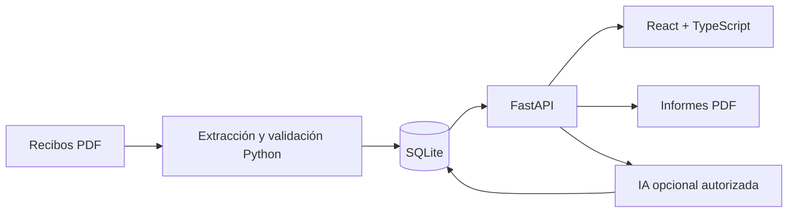

<div align="center">

# ⚡ EnerScope AI

### Análisis energético y financiero de recibos CFE

**Python · FastAPI · React · TypeScript · SQLite**

   

*Proyecto independiente; no afiliado ni avalado por CFE.*

</div>

## Descripción

EnerScope AI es una aplicación local de análisis de recibos de electricidad en PDF. Organiza servicios y plazas por RPU, calcula indicadores energéticos y económicos con Python, muestra dashboards y permite generar informes PDF. Las interpretaciones de IA son **opcionales** y están separadas de los cálculos verificados.

> **Edición pública:** el código fuente se publica sin RPU de clientes, bases SQLite, recibos privados, credenciales ni datos operativos. El catálogo de correspondencias puede configurarse desde la aplicación. **Este repositorio no equivale al ZIP privado de instalación con el frontend ya compilado.**

## Funcionalidades

- Importación de recibos PDF con revisión de los campos extraídos.
- Prevención de duplicados por hash y comprobación de periodos del servicio.
- Catálogo editable de plazas y RPU.
- Historial ordenable y filtros por empresa, servicio y periodo.
- Consumo eléctrico, demanda, costo unitario sin IVA y conciliación económica.
- Cargos y bonificaciones por factor de potencia.
- Análisis IA opcionales, persistentes y reutilizables.
- Informes técnicos PDF bajo solicitud explícita.
- SQLite local, sin precargar datos operativos.

## Arquitectura



## Instalación desde el código fuente (Windows)

Se necesita **Python 3.12 x64**, Node.js y npm para compilar el frontend:

```powershell
py -3.12 -m venv .venv
.\.venv\Scripts\python.exe -m pip install -r requirements.txt
npm.cmd --prefix frontend ci
npm.cmd --prefix frontend run build
.\.venv\Scripts\python.exe scripts/verify_frontend.py
.\.venv\Scripts\python.exe run.py
```

Abre http://127.0.0.1:8000. El directorio `frontend/dist` no se distribuye como código fuente y debe compilarse antes de iniciar esta edición.

## Seguridad y privacidad

**No publiques** recibos, RPU reales, credenciales, datos de clientes, bases de datos o tokens en issues o pull requests. El servidor está diseñado para ejecutarse localmente; no lo expongas a Internet sin autenticación y auditoría de seguridad. El uso de IA puede transmitir contenido del recibo con consentimiento.

Consulta [SECURITY.md](SECURITY.md) y [CONTRIBUTING.md](CONTRIBUTING.md).

## Estado del proyecto

**v0.3.0 · Publicación de código fuente.** Las pruebas reportadas corresponden a la distribución interna; la edición pública necesita compilación y validación adicional. La integración directa con el portal CFE **no está implementada**.

## Créditos

Proyecto dirigido por [@g3mixx](https://github.com/g3mixx), con asistencia de Codex y ChatGPT (OpenAI) en programación, documentación y revisión. Las herramientas de IA no son cuentas de GitHub ni colaboradores humanos. Consulta [CONTRIBUTORS.md](CONTRIBUTORS.md).

## Licencia

Sin licencia de código abierto elegida todavía. El autor conserva los derechos de reutilización hasta que publique un archivo LICENSE.
